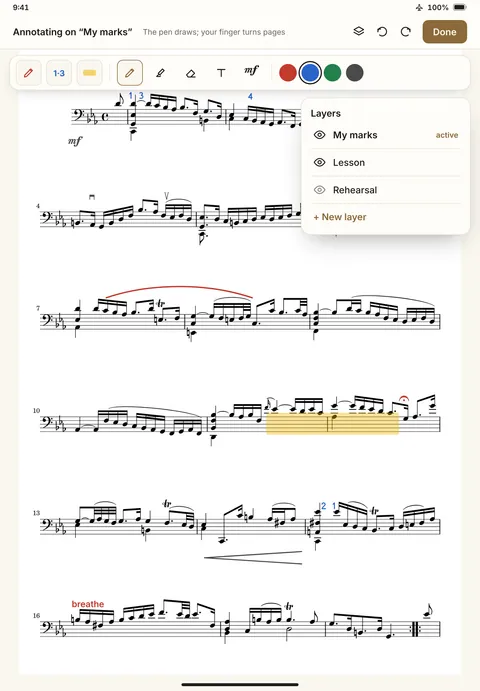
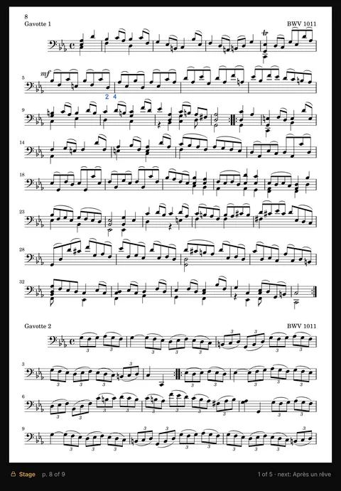
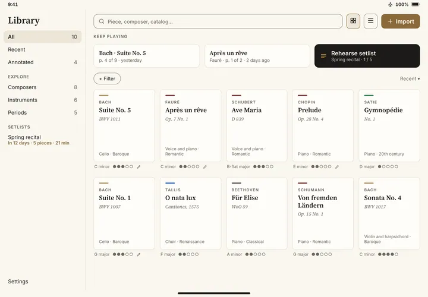
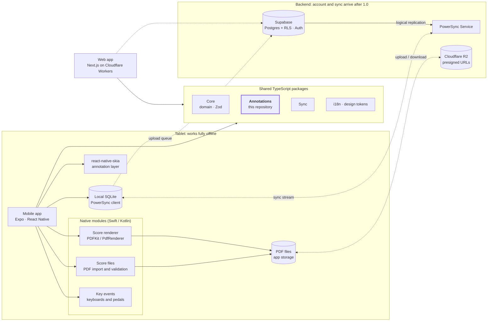

# Codetta · annotation engine

**[Codetta](https://getcodetta.app) is a sheet-music reader for musicians: tablet first, fully offline.** You import your PDF scores, annotate them in layers with the pencil, build setlists and play from them in a distraction-free Stage mode. Version 1.0, a free tablet app, is planned for the App Store and Google Play.

This repository contains one piece of it, **the annotation engine** (`@codetta/annotations`), with its tests, benchmarks and measurement scripts. It is the TypeScript package that the tablet app (React Native) and the web reader share for everything the pencil leaves on a page. The rest of the product (the app, its native modules, sync, the backend and the website) lives in a private repository. **I can show it on request.**

<p align="center">
  
  
</p>
<p align="center">
  
</p>
<p align="center"><sub>Design mockups from the product's landing page, not screenshots of the app.</sub></p>

## Where it fits



The product rules that shape this package:

1. **100 % offline.** Every read and write goes to the local database; the network never blocks the UI ([ADR-003](docs/adr/003-offline-sync.md)).
2. **Page turns under 50 ms.** Nothing heavy runs on the JS thread during a turn ([ADR-013](docs/adr/013-reader.md)).
3. **Annotations use normalized 0–1 page coordinates,** one database row per element, and are never flattened except on export ([ADR-008](docs/adr/008-annotation-model.md)).
4. **User data is always exportable.**

## What is in the engine

Pure TypeScript, with no React and no Node APIs in shipped code (ESLint enforces both). It runs in Hermes (the app's JS thread and its UI-thread worklets) and in the browser.

- **Normalized page frame** ([ADR-008 §1](docs/adr/008-annotation-model.md)). Every annotation lives in 0–1 coordinates of the page's visible frame (CropBox ∩ MediaBox, then `/Rotate`), the same frame the native renderers and pdf.js draw, so a mark stays put across devices, zoom levels and the exported PDF. `src/geometry/`.
- **Stroke smoothing** ([§4](docs/adr/008-annotation-model.md)). An incremental outline derived from perfect-freehand: each new pencil sample costs amortized O(1) instead of recomputing the stroke, and every function is a Reanimated worklet, so the live stroke is drawn on the UI thread. A golden test pins its output. `src/smoothing/`.
- **Point codec** ([§3](docs/adr/008-annotation-model.md)). `[x, y, pressure, t]` is quantized at capture time and stored as zigzag varint deltas in base64url. That is **5.8 characters per point, against 30.9 for JSON decimals and 77.6 for raw floats**, and a 50-point stroke takes 292 characters. The decoder never throws on bad input (2,000 random inputs check it), and it can decode a stroke in parts, so a 10,000-point stroke never blocks a frame. `src/codec/`.
- **Chunked page preparation** ([§7](docs/adr/008-annotation-model.md), [ADR-013 §4–§5](docs/adr/013-reader.md)). Preparing a page has two phases. First, `pageFromCache` builds the page from `id` and `updated_at` alone. Then `PageJob` prepares whatever is missing (validate, decode, outline, eraser box) in **chunks of at most 8 ms**, which yield between frames and even split a single long stroke. It learns each step's cost as it runs and never starts a step that would overrun the budget. `src/page/`.
- **Eraser** ([§5](docs/adr/008-annotation-model.md)). Whole-stroke hit testing against the drawn width at full pressure, with shapes against their centre lines and text and stamps against their boxes; a bounding-box check comes first. `src/hit-test/`.
- **Undo history** ([§6](docs/adr/008-annotation-model.md)). Pure undo and redo for an open score, across its pages. Undo and redo return the mutations for the repository to apply and never touch the database themselves. `src/history/`.
- **Rows, schemas and stamps.** Zod schemas for every row and payload, with versioned formats that older apps keep reading, and ink keys instead of hex values. Stamps are SMuFL glyphs, whose outlines are generated from Bravura. `src/schema/`, `src/stamps/`.
- **Annotated PDF export** ([ADR-014](docs/adr/014-annotated-pdf-export.md)). `src/pdf/content.ts` turns a page's annotations into PDF operators: highlights first with their own graphics state, then pen strokes, shapes, text in WinAnsi and stamps. These are the same operators whatever writes the file. This repository also has the first option, a pdf-lib export, with its bench.
  - **The app uses an incremental update instead.** It appends only the new objects to the original file and reads only what it needs. On a synthetic 342-page book shaped like a scan (121 MB), measured on an Android tablet emulator, **5 annotated pages took about 3 s against 71 s with pdf-lib**, and the whole book took 49–87 s with a memory increase of 99–112 MB.
  - **That writer is in the private repository:** a small PDF lexer, an xref reader and the incremental writer, in the app's core package. ADR-014 has the design and every measurement.

### Measurements

The benchmark cases in `src/bench/` are the same ones that the app's measuring screen runs on Hermes on the device. The figures below are from **Node 24.22 (V8 with JIT) in a cloud container**, one run of `pnpm perf-report` and `pnpm pdf-report`, so treat them as a lower bound. The ADRs have the Hermes figures from an Android tablet emulator: there the same code runs 6 to 16 times slower than V8 on the same PC (ADR-008 §7), and the figures below come from a faster machine.

| Operation                                                   | p50      | p95      | Budget (device) |
| ----------------------------------------------------------- | -------- | -------- | --------------- |
| Live event, incremental outline, 10,000-point stroke        | 0.001 ms | 0.002 ms | ≤ 0.5 ms        |
| … the same, recomputing with perfect-freehand, 4,000 points | 0.19 ms  | 0.53 ms  | —               |
| Finished outline, 2,000 points                              | 0.41 ms  | 0.71 ms  | ≤ 2 ms          |
| Decode 10,000 points                                        | 0.40 ms  | 0.48 ms  | —               |
| Page of 300 strokes × 100 points, cold (`preparePage`)      | 19 ms    | 19 ms    | — (chunked)     |
| … from the cache (`pageFromCache`)                          | 0.076 ms | 0.13 ms  | ≤ 30 ms         |
| Each `PageJob` chunk on that page, cold                     | 6.5 ms   | 6.5 ms   | ≤ 8 ms          |
| Each `PageJob` chunk on one 10,000-point stroke             | 0.13 ms  | 2.7 ms   | ≤ 8 ms          |
| One eraser move, 500 strokes on the page                    | 0.016 ms | 0.045 ms | ≤ 1 ms          |

Annotated PDF export with pdf-lib, every page annotated (`pnpm pdf-report`, synthetic scanned books):

|                                | Score, 19 pages | Book, 342 pages  |
| ------------------------------ | --------------- | ---------------- |
| Size, input → output           | 6.7 → 7.3 MB    | 121.4 → 131.3 MB |
| Total                          | 425 ms          | 6.5 s            |
| Longest block of the JS thread | 48 ms           | 43 ms            |

On Hermes (no JIT) the same pdf-lib export of the book took about 2.4 minutes on the emulator, which is why the app writes an incremental update instead (ADR-014).

## Repository layout

| Path                  | What it is                                                                                         |
| --------------------- | -------------------------------------------------------------------------------------------------- |
| `src/`                | The engine, with each test next to its module (`*.test.ts`)                                        |
| `src/bench/`          | Benchmark cases shared with the app's measuring screen; kept out of shipped code by ESLint         |
| `scripts/`            | `size-report`, `perf-report`, `pdf-report` and `outline-golden`                                    |
| `fixtures/`, `fonts/` | The PDFs the export tests read, and Bravura and Inter (see their READMEs for sources and licenses) |
| `docs/adr/`           | Condensed English versions of four of the project's architecture decision records                  |

## Running it

Node.js 24 and pnpm 12.

```sh
pnpm install
pnpm typecheck && pnpm lint && pnpm test   # what CI runs

pnpm size-report    # bytes per point of each candidate encoding
pnpm perf-report    # timings of the hot paths, printed as a Markdown table
pnpm pdf-report     # the annotated-PDF export on a 342-page synthetic book (under a minute in Node)
pnpm generate       # regenerate the SMuFL stamp outlines from Bravura
```

## How it is built

TypeScript `strict` everywhere, Zod at every boundary and no `any` without a comment saying why. Every significant decision is written down as an ADR with the measurements behind it, including the budgets it misses. I work with [Claude Code](https://claude.com/claude-code) as a pair programmer under written rules: a plan before any non-trivial change, small reviewed pull requests, tests next to the code, and figures from release builds before a performance claim.

## Author

Pablo Rodríguez Vargas · [LinkedIn](https://www.linkedin.com/in/pablo-rodriguez-granada)

## License

All rights reserved: this repository is published for viewing only (see [LICENSE](LICENSE)). The SMuFL stamp outlines in `src/stamps/generated/` are derived from Bravura and, like the bundled Bravura and Inter fonts, are under the SIL Open Font License 1.1 (`fonts/*/OFL.txt`).
